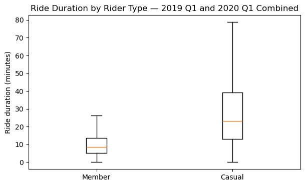
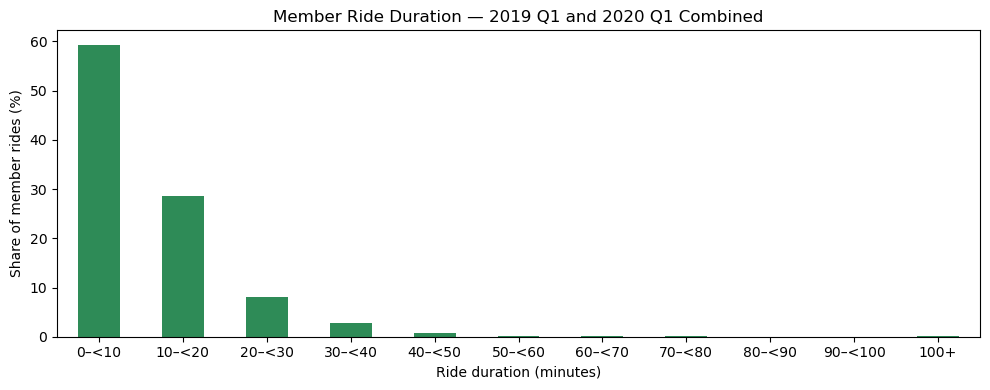
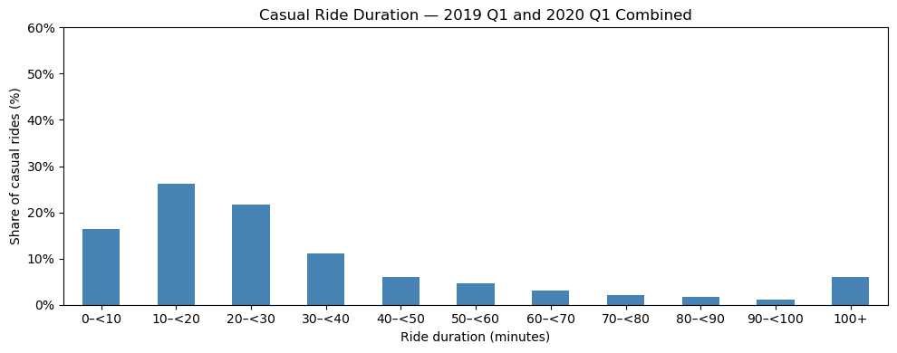
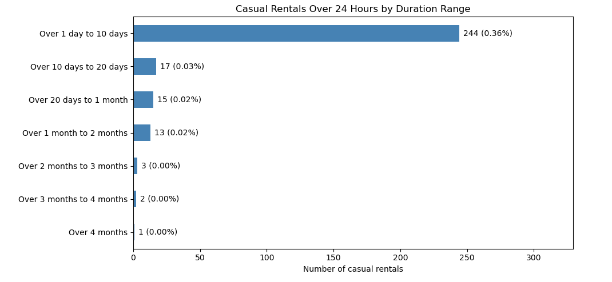

# Cyclistic Ride Duration Analysis in Python

**Role** — Junior Data Analyst  
**Data** — Divvy trips from January–March 2019 and January–March 2020  
**Tools** — Python, pandas, Matplotlib, seaborn, and JupyterLite

## Business Objective

My goal is to convert more casual riders into members. Building on my SQL analysis, I used Python to investigate first-quarter ride duration in more detail. I compared how long members and casual riders typically rode, how their trips were distributed across duration bands, and how the longest recorded rentals affected the averages. These findings help me assess membership options that could serve different usage patterns. [BigQuery analysis](../sql/bigquery-review/README.md)

## Data Preparation

I imported `Divvy_Trips_2019_Q1.csv` and `Divvy_Trips_2020_Q1.csv`, aligned the column names, converted ride IDs to strings, and combined both quarters. I mapped `Subscriber` to `member` and `Customer` to `casual`. I calculated each trip’s duration in minutes from its start and end timestamps. The duration analysis uses positive durations and excludes trips that both started and ended at `HQ QR`. The resulting dataset contains **788,190 trips**. Each row represents a trip. [Divvy trip data](https://divvy-tripdata.s3.amazonaws.com/index.html)

## Key Findings

### 1. Casual trips typically lasted longer and varied more in length

| Rider type | Trips | 25th percentile | Median | 75th percentile | Mean |
| --- | ---: | ---: | ---: | ---: | ---: |
| Member | 720,312 | 5.28 min | 8.47 min | 13.72 min | 13.25 min |
| Casual | 67,878 | 13.00 min | 23.22 min | 39.32 min | 89.55 min |

The middle half of member trips lasted about **5 to 14 minutes**. For casual trips, it lasted about **13 to 39 minutes**. The median casual trip was about **15 minutes longer** than the median member trip. I hid individual outlier markers in the box plot to make the central distributions easier to compare. The duration statistics include those records.

### 2. The most common duration band differed by rider type

For members, **59.30%** of trips lasted under 10 minutes. For casual riders, the largest band was **10 to under 20 minutes** at **26.28%**, followed by **20 to under 30 minutes** at **21.73%**. I checked each quarter separately and found the same leading band for each rider type in both years. Each percentage uses all positive-duration trips for the corresponding rider type as its denominator.

### 3. A small share of very long records had a large effect on the mean

Among casual trips, **4,036 (5.95%)** lasted at least 100 minutes and **2,913 (4.29%)** exceeded two hours. Across both rider types, **482 rentals** had a recorded duration over 24 hours, including **295 casual rentals** and **187 member rentals**.

The chart shows the **295 casual rentals** that exceeded 24 hours. Each rental appears in exactly one duration range. The percentages use **all 67,878 casual rentals** as the denominator. **244 rentals (0.359% of all casual rentals)** lasted over one day and up to 10 days. Together, the displayed ranges account for **0.435%** of all casual rentals.

I tested how much the longest records affected the overall casual trip statistics. I ranked all casual trips across both first quarters by duration and recalculated the mean and median after excluding the 10 longest records.

| Casual trips included | Trip count | Mean (min) | Median (min) |
| --- | ---: | ---: | ---: |
| All qualifying casual trips | 67,878 | 89.55 | 23.22 |
| After excluding the 10 longest records | 67,868 | 73.86 | 23.22 |

Those 10 records made up about **0.015%** of casual trips. Excluding them lowered the mean by **15.69 minutes (17.52%)**, and the median stayed at **23.22 minutes**.

I also recalculated the mean by day of departure after excluding the same 10 trips.

| Departure day | Trips excluded | Mean before (min) | Mean after (min) |
| --- | ---: | ---: | ---: |
| Monday | 0 | 79.20 | 79.20 |
| Tuesday | 1 | 76.03 | 66.53 |
| Wednesday | 1 | 74.67 | 64.97 |
| Thursday | 3 | 140.84 | 82.86 |
| Friday | 1 | 101.51 | 86.88 |
| Saturday | 1 | 82.51 | 77.65 |
| Sunday | 3 | 84.36 | 67.01 |

The daily means ranged from **74.67 to 140.84 minutes** before the exclusion and from **64.97 to 86.88 minutes** afterward. The gap between the highest and lowest means narrowed from **66.17 to 21.91 minutes**. Thursday had the largest drop (**57.98 minutes**), and Friday had the highest remaining mean (**86.88 minutes**).

I kept these records in the main distribution and excluded the 10 longest only to measure their effect on the mean. The timestamps measure elapsed rental time. Active riding time and the reasons for longer rentals would require additional data.

## Top Three Recommendations

### 1. Test monthly, quarterly, and annual membership options

I would offer casual riders a choice of membership terms so they could pick a commitment that fits how long they expect to use the service. I would track which terms riders select and compare the overall sign-up rate with a group shown the existing membership options.

### 2. Recommend membership plans based on past rides

The median casual trip lasted **23.22 minutes**, compared with **8.47 minutes** for members. To make the comparison useful to individual riders, I would use each rider’s past trips to estimate their median trip length and show how their ride durations vary. I would also use their monthly ride count and total ride minutes to recommend a plan with an allowance that fits their usage.

This test would require account-linked trip history from the operator. The public trip data supports comparisons by rider type. I would compare sign-up rates between casual riders shown a personalized in-app recommendation and a group shown the standard plan overview.

### 3. Pilot a multi-day pass and measure demand

Across the two first quarters, **295 casual rentals (0.435% of all casual rentals)** exceeded 24 hours. I would run a small multi-day pass pilot and track uptake. I would also check whether pass buyers later choose a membership and which term they select. This would help assess whether a multi-day option serves a distinct need and creates another route to membership.

## Proposed Membership Conversion Model

I would build a model to estimate the probability that a current casual rider becomes a member within the next 30 days. I chose 30 days as a starting point because it gives the marketing team a forecast for the next monthly campaign. A quarterly campaign could use a longer prediction window.

| Component | First version |
| --- | --- |
| Eligible riders | Users who are still non-members on the prediction date, with one row per eligible user on that date. |
| Riding history | Calculate trip count, total riding minutes, and median trip duration over the previous 30 and 90 days. Also calculate days since the user's last ride. Use only information available before the prediction date. |
| Outcome | Label users `1` if they join within the next 30 days. Label users `0` if they remain non-members for the full 30 days. Users with incomplete follow-up are excluded from this comparison. |
| Baseline model | Fit logistic regression to estimate the probability of the binary outcome. |
| Validation | Train on earlier prediction dates and test on later dates. At the start of the test period, all training outcomes must already be observable. Use the same lookback rules on training and test dates. |

Training and validation require account-linked trip histories and membership start dates from the operator, joined by an anonymous rider identifier. The public Divvy data contains trip IDs and rider categories, so I used it to identify candidate features for this proposal.
